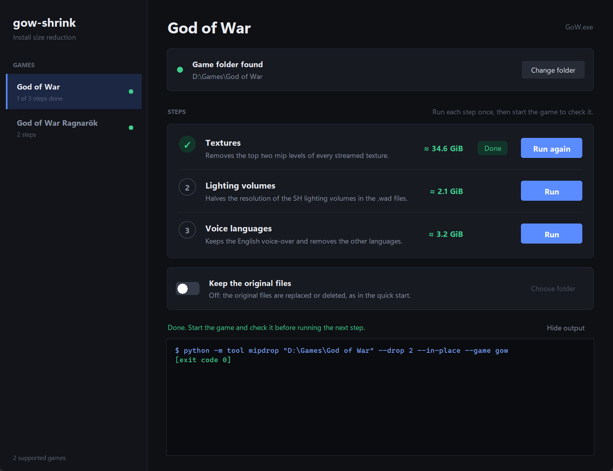

# gow-shrink

A tool that reduces the install size of PC games by rewriting or removing their resource files. Each supported game gets its own set of steps, such as lowering texture resolution, shrinking lighting data and removing voice-over languages you do not use, and each step is tested in game before it is listed. The games and their steps are defined in `tool/games.json`, and more games will be added.

Requires Python 3.11+. Some steps need extra packages (for example NumPy or `lz4`); they are listed with each game below, and the desktop app offers to install them.

## Supported games

| Game | Executable | Install size (`exec\`) | After the quick start | Extra packages |
|---|---|---|---|---|
| God of War (2018) | `GoW.exe` | about 65 GB | about 25 GB | NumPy (`shvol` only) |
| God of War Ragnarök | `GoWR.exe` | about 176 GB | about 70 GB | `lz4` |

- "After the quick start" is the install size minus the savings of every quick start step (see [Results](#results)).
- Games that are not in this table are not supported yet. Each game needs its own analysis of its file formats.
- The texture commands detect the game from the `.texpack` version, so the same commands work for both games.
- Other builds of the supported games may work if `verify` reports `[OK]` on the unmodified files. `mipdrop` skips any file whose structure fails verification.
- Every command except `restore` accepts `--game gow` (God of War 2018) or `--game gowr` (Ragnarök). Without it, the game is detected from the `.texpack` version or from `GoW.exe` / `GoWR.exe` in a parent folder. With it, the command refuses files that belong to the other game. A command that the game does not support (for example `shvol` on Ragnarök) is refused either way.

## Desktop app



`gow_shrink.pyw` in the repository folder runs the quick start steps below from a window. Double-click it, or run `python gow_shrink.pyw`. Pick the game in the list on the left, choose its folder, and press **Run** on each step. The games and their steps come from the `app` section of each game in `tool/games.json`. Turn on **Keep the original files** to move the originals to a backup folder (one subfolder per game and step, for example `<BackupDir>\gow-mipdrop`); undo a step with `python -m tool restore --backup "<BackupDir>\gow-mipdrop"`. Other commands and options are only available from the command line.

## Quick start

Run the commands from the repository folder in Command Prompt. Replace `<GameDir>` with the folder that contains the game's `.exe`, and keep the quotes. Given the game folder, each command finds the subfolder it works on (`exec\wad\pc_le` or `exec`) by itself; you can still pass that subfolder, or single files, directly. The per-game executable names and subfolders are listed in `tool/games.json`. These commands replace game files directly, so run each one once and start the game after each step. To keep the originals so a step can be undone with `restore`, add `--backup "<BackupDir>"` (see each tool's section below).

### God of War (2018)

```bat
python -m tool mipdrop "<GameDir>" --drop 2 --in-place --game gow
python -m tool shvol "<GameDir>" --game gow
python -m tool lang "<GameDir>" --keep english --game gow
```

### God of War Ragnarök

```bat
python -m pip install lz4
python -m tool mipdrop "<GameDir>" --drop 2 --in-place --game gowr
python -m tool lang "<GameDir>" --keep english --game gowr
```

## Results

### God of War (2018)

| Step | Command | Saved | Status |
|---|---|---|---|
| Textures (`.texpack`) | `mipdrop --drop 2` | 34.6 GiB | Verified in game |
| Lighting volumes (`.wad`) | `shvol` | 2.1 GiB | Verified in game |
| Voice languages | `lang --keep english` | 3.2 GiB | Verified in game |

All three steps were applied to one install and the game was played through without problems. The texture step there was at the `--drop 3` level (2.92 GiB of textures), and `exec\` went from about 65 GB to 24 GB.

### God of War Ragnarök

| Step | Command | Saved | Status |
|---|---|---|---|
| Textures (`.texpack`) | `mipdrop --drop 2` | 89.0 GiB | Verified in game |
| Lighting volumes (`.wad`) | `shvol` | - | Not supported |
| Voice languages | `lang --keep english` | 16.7 GiB | Verified in game |

## Textures (`mipdrop`)

`mipdrop` removes the top mip levels of every streamed texture in the `.texpack` files. Settings, savings per game, options and the Ragnarök specifics are in [guide/mipdrop.md](guide/mipdrop.md).

## Lighting volumes (`shvol`)

`shvol` halves the resolution of the spherical-harmonics (SH) lighting volumes in `.wad` files. These are 3D textures named `<8 hex digits>SH0` to `SH3` (868 volumes in 185 wads, 2.41 GiB). Each volume is downsampled 2x on every axis with a 2x2x2 box filter, so its data shrinks to about 1/8. All `.wad` files go from 12.61 GiB to 10.52 GiB.

The change has been tested in game by playing through with all three steps applied.

Show what would change (does not touch any file):

```bat
python -m tool shvol "<GameDir>" --dry-run
```

Apply, keeping the originals so the change can be undone:

```bat
python -m tool shvol "<GameDir>" --backup "<BackupDir>\shvol"
```

- A resized volume shifts every later entry in the wad. The tool rewrites the whole wad, updates the entry sizes, the GNF header (width, height, depth, pitch, data size) and the descriptor size field, and recomputes every `autopad` entry so the next entry still starts on a 64 KiB boundary.
- Before a rewritten wad replaces the original, the tool checks that entry order and names are unchanged, all non-SH entries are byte-identical, `autopad` alignment holds, and the SH fields match the new data. Rebuilding at the original resolution reproduces all 185 wads byte for byte.

## Voice languages (`lang`)

`lang` lists the installed voice languages and removes all but the ones you keep. Where each game stores them, the text -> voice mapping, commands and options are in [guide/lang.md](guide/lang.md).
